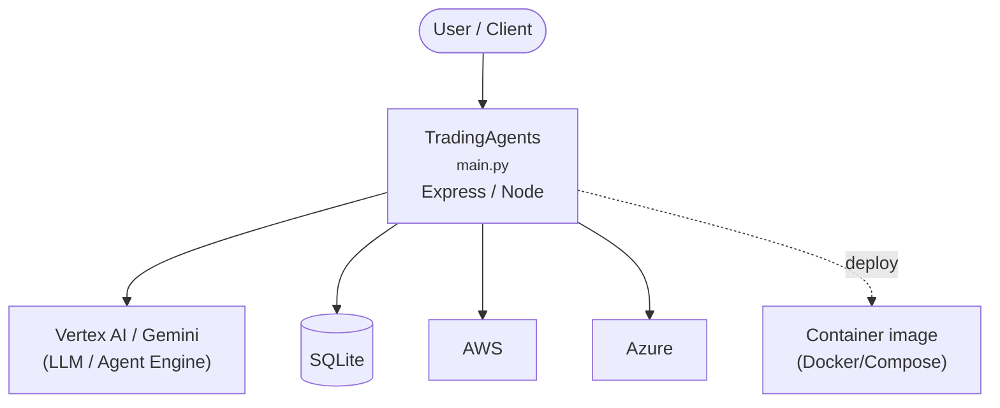

# Context Map — `TradingAgents`

> Auto-generated architecture & deployment context map. Summarizes the core application, container/cloud footprint, and database connections. Regenerate after significant structural changes.

**Repo:** `avnit/TradingAgents` · **Fork** · Public · Primary language: Python · Default branch: `main` · Files: 160

**Description:** TradingAgents: Multi-Agents LLM Financial Trading Framework

## 1. Core application

<!-- Keep these links. Translations will automatically update with the README. -->

- **Frameworks / runtime:** Express / Node
- **Entry points:** `cli/main.py`, `main.py`
- **Listens on port(s):** 11434

## 2. Containers & cloud applications

**Containers:**
- `.dockerignore`
- `Dockerfile`
- `docker-compose.yml`

**Detected cloud platforms / services:** Vertex AI / Gemini (GCP), AWS, Azure

## 3. Database connections

**Datastores in use:** SQLite

**Referenced in:**
- `tradingagents/graph/checkpointer.py`

**Environment / config files:** `.env.enterprise.example`, `.env.example`

## 4. Architecture diagram

## 5. Security posture

- **Static scan findings:** 1 high

| Severity | Rule | File:Line |
|---|---|---|
| high | sql-string-concat | `tradingagents/graph/checkpointer.py:93` |

---
_Generated by repo context-mapping pass on 2026-08-13._